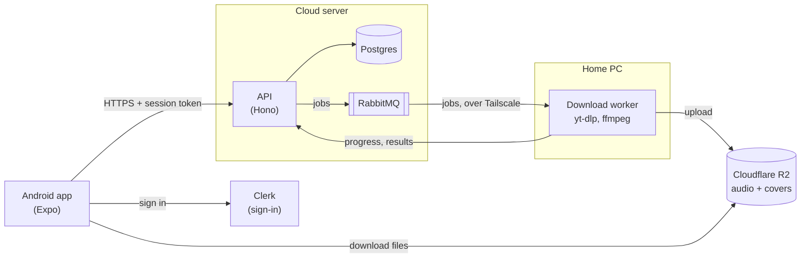

# Pluck

A personal music library for Android. Paste a YouTube, SoundCloud or Bandcamp link, pick songs from the charts, or upload your own files. A worker on your home PC downloads each song at the best quality available and adds the title, artist, album, cover art and lyrics. Your phone keeps a copy of the whole library, so everything plays offline.

**Built so far:** the API, the download worker, the Android app, and the local setup that runs the backend.
**Next:** deploying the API to a free cloud server with Terraform. The installed app needs it, because a release build only connects over `https://`.

## How it fits together



1. The app asks the API to download a link. The API saves the request in Postgres and puts a job on a RabbitMQ queue.
2. The worker on your PC takes the job, downloads and tags the song, and uploads it to storage.
3. The API records the new song. The app hears about it over a live event stream, then downloads the file to the phone.

Downloads run on your PC because YouTube blocks most requests from cloud servers.

## Repository layout

| Path                                     | What it is                                                                  |
| ---------------------------------------- | --------------------------------------------------------------------------- |
| [apps/mobile](apps/mobile)               | Android app (Expo): library, player, downloads, music folder                |
| [apps/api](apps/api)                     | HTTP API: library, playlists, downloads, sync, sign-in checks               |
| [apps/worker](apps/worker)               | Download worker: yt-dlp, ffmpeg, tagging, upload                            |
| [packages/contracts](packages/contracts) | Request, response, job and event shapes, as Zod schemas shared by every app |
| [packages/db](packages/db)               | Postgres schema and migrations (Drizzle)                                    |
| [packages/messaging](packages/messaging) | RabbitMQ queues, retries and events                                         |
| [packages/catalog](packages/catalog)     | Clients for Deezer, Apple Music charts, LRCLIB lyrics and YouTube search    |
| [packages/core](packages/core)           | Logic with no I/O: title matching, file paths, loudness, playlist order     |
| [deploy/worker](deploy/worker)           | Docker Compose for running the worker on your PC                            |
| [docs/learning](docs/learning)           | Notes explaining each tool and why it is used                               |
| [docs/adr](docs/adr)                     | Architecture decision records: what was decided, and why                    |

## Quick start on Windows

This runs the whole backend on your PC in Docker. You only need Git and Docker; Node is not needed for this.

### 1. Install

- [Git for Windows](https://git-scm.com/download/win)
- [Docker Desktop](https://www.docker.com/products/docker-desktop/). Keep the default WSL 2 option. Start it once and wait until it says it is running.

### 2. Set up Clerk (sign-in)

1. Create a free account at [clerk.com](https://clerk.com) and an application called Pluck. Turn on sign-in with an email verification code. The app signs in only this way.
2. In **Configure > Restrictions**, set the sign-up mode to **Restricted**, so nobody else can make an account.
3. In **Users**, create a user with your email. Open it and copy its id (`user_…`).
4. In **API keys**, copy the secret key (`sk_test_…`).

### 3. Configure

In PowerShell:

```powershell
git config --global core.longpaths true
mkdir C:\dev
cd C:\dev
git clone https://github.com/MichaelChung888/pluck.git
cd pluck
Copy-Item .env.example .env
notepad .env
```

Keep the folder path short. `pnpm install` creates deeply nested folders, and Windows refuses paths over 260 characters unless long paths are on.

Fill in:

| Setting                  | Value                                                                                                          |
| ------------------------ | -------------------------------------------------------------------------------------------------------------- |
| `CLERK_SECRET_KEY`       | The secret key from step 2                                                                                     |
| `CLERK_ALLOWED_USER_IDS` | Your user id from step 2                                                                                       |
| `WORKER_TOKEN`           | A long random string. In Git Bash: `openssl rand -base64 48`                                                   |
| `S3_PUBLIC_ENDPOINT`     | `http://<your PC's IP>:9000`. Find the IP with `ipconfig` (IPv4 Address). The phone downloads files from here. |

Leave everything else as it is.

### 4. Start

```powershell
docker compose --profile app up -d --build
```

The first build takes several minutes. When it finishes, `docker compose ps` shows every service as running or healthy. If Windows asks whether Docker may use private networks, allow it: the phone needs to reach your PC.

| Address                      | What is there                                                      |
| ---------------------------- | ------------------------------------------------------------------ |
| http://localhost:3000/health | The API                                                            |
| http://localhost:15672       | RabbitMQ's web UI, user `pluck`, password `pluck`                  |
| http://localhost:9001        | The storage console, user `pluck-dev`, password `pluck-dev-secret` |

### 5. Try it

Without the app, you can call the API from PowerShell. This gets a sign-in token for your Clerk user and starts a download:

```powershell
$token = docker compose exec -T api node apps/api/scripts/token.ts
$auth = @{ Authorization = "Bearer $token" }
Invoke-RestMethod http://localhost:3000/v1/status -Headers $auth

$body = @{ id = [guid]::NewGuid().ToString(); source = @{ kind = 'url'; url = 'https://www.youtube.com/watch?v=dQw4w9WgXcQ' } } | ConvertTo-Json
$download = Invoke-RestMethod http://localhost:3000/v1/downloads -Method Post -Headers $auth -ContentType 'application/json' -Body $body
Invoke-RestMethod "http://localhost:3000/v1/downloads/$($download.id)" -Headers $auth
```

Run the last line again after a minute and the status changes to `completed`. The song is in the storage console under the `pluck` bucket. `docker compose logs -f worker` shows each step as it happens.

### Stop, update, reset

| Task                    | Command                                      |
| ----------------------- | -------------------------------------------- |
| Stop                    | `docker compose --profile app down`          |
| Update after `git pull` | `docker compose --profile app up -d --build` |
| Delete all local data   | `docker compose --profile app down -v`       |

## Try the app on an emulator

An emulator is a virtual Android phone that runs in a window on your PC. This builds a debug version of the app on your PC and installs it there. A debug build allows plain `http://`, so it works with the backend from the quick start, before any cloud deploy.

The backend must be running (quick start step 4), and you need Node 24 and pnpm (see [Developing](#developing)).

### 1. Install the Android tools

1. Install [Android Studio](https://developer.android.com/studio). Open it once and finish the setup wizard with the standard options. It downloads the Android SDK, which is the set of tools that builds Android apps.
2. Install Java 17, which the Android build needs:

   ```powershell
   winget install Microsoft.OpenJDK.17
   ```

3. Tell the build where both are. In PowerShell:

   ```powershell
   $jdk = (Get-ChildItem 'C:\Program Files\Microsoft\jdk-17*')[0].FullName
   [Environment]::SetEnvironmentVariable('JAVA_HOME', $jdk, 'User')
   [Environment]::SetEnvironmentVariable('ANDROID_HOME', "$env:LOCALAPPDATA\Android\Sdk", 'User')
   $path = [Environment]::GetEnvironmentVariable('Path', 'User')
   [Environment]::SetEnvironmentVariable('Path', "$path;$env:LOCALAPPDATA\Android\Sdk\platform-tools", 'User')
   ```

   Close the terminal and open a new one, so it sees the new settings.

### 2. Create a virtual phone

In Android Studio, open **More Actions > Virtual Device Manager** (or **View > Tool Windows > Device Manager** if a project is open).

1. Click **+**, pick **Pixel 9**, then **Next**.
2. Pick the newest system image marked **Google Play** for `x86_64`. Download it if asked.
3. Finish, then press the play button next to the new device. The phone starts in a window.

### 3. Point the app at your PC

```powershell
cd C:\dev\pluck
pnpm install
Copy-Item apps/mobile/.env.example apps/mobile/.env
notepad apps/mobile/.env
```

| Setting                             | Value                                                                                |
| ----------------------------------- | ------------------------------------------------------------------------------------ |
| `EXPO_PUBLIC_API_URL`               | `http://<your PC's IP>:3000`, the same IP as `S3_PUBLIC_ENDPOINT` in the root `.env` |
| `EXPO_PUBLIC_CLERK_PUBLISHABLE_KEY` | The publishable key (`pk_test_…`) from **API keys** in the Clerk dashboard           |

The emulator reaches your PC on its network address, like a real phone would. If it cannot connect, use `10.0.2.2` instead of the IP in both settings: inside the emulator, that address means the PC it runs on. Restart the backend after changing the root `.env`.

### 4. Build and run

With the virtual phone running:

```powershell
pnpm --filter @pluck/mobile android
```

The first build takes 10 minutes or more. Later builds are much faster. When it finishes, the app opens on the virtual phone. Then follow [First run](#4-first-run) below.

The command keeps running: it is Metro, the server that sends the app's JavaScript to the phone. Saving a change to the code reloads the app within a second. Press `Ctrl+C` to stop it. Run the same command again next time.

### A real phone over USB

The same steps work with your own phone in place of the virtual one:

1. On the phone, open **Settings > About phone** and tap **Build number** seven times. This turns on **Developer options**.
2. In **Developer options**, turn on **USB debugging**.
3. Plug the phone into the PC and allow debugging when the phone asks.
4. Run `pnpm --filter @pluck/mobile android`. The phone must be on the same Wi-Fi as the PC, and `.env` must use the PC's IP, not `10.0.2.2`.

A build made this way is signed with a different key from the APK built by EAS. To switch from one to the other, uninstall the app first. See [Signing](docs/learning/expo-and-the-apk.md#signing).

## The Android app

The app is installed as an APK, built on Expo's servers (EAS Build) so you do not need Android tools on your computer. [Expo, and how the app becomes an APK](docs/learning/expo-and-the-apk.md) explains each step.

The APK only connects to `https://` addresses, so it needs the API deployed to the cloud first. Until then, [try the app on an emulator](#try-the-app-on-an-emulator).

### 1. Set up EAS

You need Node 24 and pnpm (see [Developing](#developing)), and a free account at [expo.dev](https://expo.dev).

```powershell
cd apps/mobile
npx eas-cli login
npx eas-cli init
```

`eas init` creates the project on expo.dev. It cannot edit `app.config.ts` itself, so it prints a project id: add it to the config as `extra: { eas: { projectId: '<the id>' } }`. The id is not a secret.

### 2. Give the build its settings

The build runs on Expo's servers, which never see your `.env`. Set the values there instead:

```powershell
npx eas-cli env:create --environment preview --visibility plaintext --name EXPO_PUBLIC_API_URL --value https://<your API address>
npx eas-cli env:create --environment preview --visibility plaintext --name EXPO_PUBLIC_CLERK_PUBLISHABLE_KEY --value pk_test_...
```

The publishable key is under **API keys** in the Clerk dashboard. Both values are built into the app, where anyone with the APK can read them, so they are not secrets.

### 3. Build and install

```powershell
npx eas-cli build --platform android --profile preview
```

Free builds wait in a queue, often for some minutes. When the build finishes, the command prints a link. Open it on your phone, download the APK, and allow your browser to install unknown apps when Android asks.

Later builds install over the old one and keep your library. They must all come from EAS: a build made elsewhere is signed with a different key, and Android will only install it after you uninstall the app.

### 4. First run

1. Sign in with your email. Clerk sends a code.
2. Choose where songs go. **A folder in Music** puts them in `Music/Pluck`, where other players can see them.
3. Paste a link in Search, or tap a download button on Home.

Songs are saved to the phone only on Wi-Fi unless you turn on mobile data in Settings.

[Known limitations](docs/known-limitations.md) lists what the app does not do yet.

## Developing

For running tests or changing the code, install [Node 24](https://nodejs.org/en/download) (pick version 24 on that page), then in a new terminal:

```powershell
npm install -g pnpm   # pnpm then switches itself to the version named in package.json
pnpm install
```

| Command                              | What it does                                                                                                                     |
| ------------------------------------ | -------------------------------------------------------------------------------------------------------------------------------- |
| `pnpm docker:up`                     | Starts Postgres, RabbitMQ and storage only, and runs the migrations                                                              |
| `pnpm api:dev`                       | Runs the API on your machine, restarting on changes                                                                              |
| `pnpm worker:dev`                    | Runs the worker on your machine. Needs yt-dlp, ffmpeg and Python with mutagen installed; the Docker worker is easier on Windows. |
| `pnpm test`                          | Unit tests                                                                                                                       |
| `pnpm test:integration`              | Tests against real Postgres and RabbitMQ, started in Docker                                                                      |
| `pnpm typecheck` / `pnpm lint`       | TypeScript and Biome checks                                                                                                      |
| `pnpm token`                         | Prints a sign-in token for calling the API                                                                                       |
| `pnpm db:generate`                   | Writes a migration after a change to `packages/db/src/schema.ts`                                                                 |
| `pnpm --filter @pluck/mobile bundle` | Builds the app's JavaScript bundle for Android, which checks every import resolves and the code compiles                         |
| `pnpm --filter @pluck/mobile icons`  | Redraws the app icons after a change to the logo                                                                                 |

Node runs the TypeScript files directly (Node 24 removes the types as it loads each file), so there is no build step.

## Learning notes

- [Authentication with Clerk](docs/learning/auth.md)
- [The offline library and sync](docs/learning/offline-sync.md)
- [Android storage and the music folder](docs/learning/android-storage.md)
- [Expo, and how the app becomes an APK](docs/learning/expo-and-the-apk.md)

The decisions behind the design, with the options that lost, are in [docs/adr](docs/adr).
