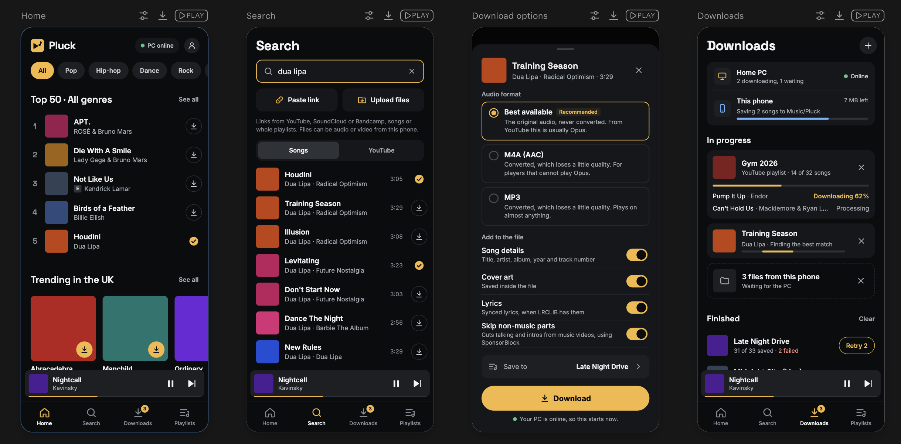
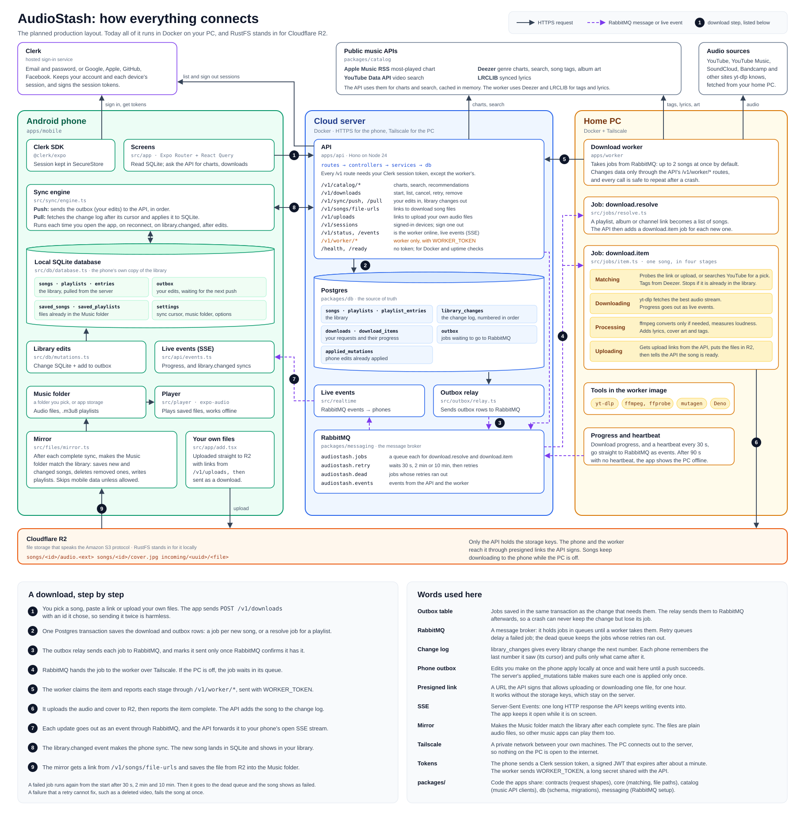

# AudioStash

A personal music library for Android. Paste a YouTube, SoundCloud or Bandcamp link, pick songs from the charts, or upload your own files. A worker on your home PC downloads each song at the best quality available and adds the title, artist, album, cover art and lyrics. Your phone keeps a copy of the whole library, so everything plays offline.



## How it fits together



1. The app asks the API to download a link. The API saves the request in Postgres and puts a job on a RabbitMQ queue.
2. The worker on your PC takes the job, downloads and tags the song, and uploads it to storage.
3. The API records the new song. The app hears about it over a live event stream, then downloads the file to the phone.

Downloads run on your PC because YouTube blocks most requests from cloud servers.

## Repository layout

| Path                                     | What it is                                                                  |
| ---------------------------------------- | --------------------------------------------------------------------------- |
| [apps/mobile](apps/mobile)               | Android app (Expo): library, player, downloads, music folder                |
| [apps/api](apps/api)                     | HTTP API: library, playlists, downloads, sync, sign-in checks               |
| [apps/worker](apps/worker)               | Download worker: yt-dlp, ffmpeg, tagging, upload                            |
| [packages/contracts](packages/contracts) | Request, response, job and event shapes, as Zod schemas shared by every app |
| [packages/db](packages/db)               | Postgres schema and migrations (Drizzle)                                    |
| [packages/messaging](packages/messaging) | RabbitMQ queues, retries and events                                         |
| [packages/catalog](packages/catalog)     | Clients for Deezer, Apple Music charts, LRCLIB lyrics and YouTube search    |
| [packages/core](packages/core)           | Logic with no I/O: title matching, file paths, loudness, playlist order     |
| [deploy/server](deploy/server)           | Docker Compose for the API, Postgres and RabbitMQ on the cloud server       |
| [deploy/worker](deploy/worker)           | Docker Compose for running the worker on your PC                            |
| [docs/learning](docs/learning)           | Notes explaining each tool and why it is used                               |
| [docs/adr](docs/adr)                     | Architecture decision records: what was decided, and why                    |

## Quick start on Windows

This runs the whole backend on your PC in Docker. You only need Git and Docker; Node is not needed for this.

### 1. Install

- [Git for Windows](https://git-scm.com/download/win)
- [Docker Desktop](https://www.docker.com/products/docker-desktop/). Keep the default WSL 2 option. Start it once and wait until it says it is running.

### 2. Set up Clerk (sign-in)

1. Create a free account at [clerk.com](https://clerk.com) and an application called AudioStash. In **Configure > User & authentication**, turn on **Email** and **Password**. Under **SSO connections**, turn on any of Google, Apple, GitHub and Facebook you want on the sign-in screen. If you later switch to a production Clerk instance (`pk_live_` keys), also add `audiostash://sso-callback` under **Configure > Native applications**. A production instance sends a sign-in back only to the addresses listed there; a development instance accepts any.
2. In **Configure > Restrictions**, set the sign-up mode to **Restricted**, so nobody else can make an account.
3. In **Users**, create a user with your email and a password. Open it and copy its id (`user_…`). A Google, Apple, GitHub or Facebook account with the same email signs in as this user.
4. In **API keys**, copy the secret key (`sk_test_…`).

### 3. Configure

In PowerShell:

```powershell
git clone https://github.com/MichaelChung888/AudioStash.git
cd AudioStash
Copy-Item .env.example .env
notepad .env
```

Keep the folder path short. `pnpm install` creates deeply nested folders, and Windows refuses paths over 260 characters unless long paths are on.

Fill in:

| Setting                  | Value                                                                                                          |
| ------------------------ | -------------------------------------------------------------------------------------------------------------- |
| `CLERK_SECRET_KEY`       | The secret key from step 2                                                                                     |
| `CLERK_ALLOWED_USER_IDS` | Your user id from step 2                                                                                       |
| `WORKER_TOKEN`           | A long random string. In Git Bash: `openssl rand -base64 48`                                                   |
| `S3_PUBLIC_ENDPOINT`     | `http://<your PC's IP>:9000`. Find the IP with `ipconfig` (IPv4 Address). The phone downloads files from here. |

Leave everything else as it is.

### 4. Start

```powershell
docker compose --profile app up -d --build
```

The first build takes several minutes. When it finishes, `docker compose ps` shows every service as running or healthy. If Windows asks whether Docker may use private networks, allow it: the phone needs to reach your PC.

| Address                      | What is there                                                                |
| ---------------------------- | ---------------------------------------------------------------------------- |
| http://localhost:3000/health | The API                                                                      |
| http://localhost:15672       | RabbitMQ's web UI, user `audiostash`, password `audiostash`                  |
| http://localhost:9001        | The storage console, user `audiostash-dev`, password `audiostash-dev-secret` |

## Try the app on a mobile emulator

An emulator is a virtual Android phone that runs in a window on your PC. This builds a debug version of the app on your PC and installs it there. A debug build allows plain `http://`, so it works with the backend from the quick start, before any cloud deploy.

The backend must be running (quick start step 4), and you need Node 24 and pnpm (see [Developing](#developing)).

### 1. Install the Android tools

1. Install [Android Studio](https://developer.android.com/studio). Open it once and finish the setup wizard with the standard options. It downloads the Android SDK, which is the set of tools that builds Android apps.
2. Install Java 17, which the Android build needs:

   ```powershell
   winget install Microsoft.OpenJDK.17
   ```

3. Install CMake 3.31.6. The Android SDK's default CMake cannot handle this project's long file paths, and the build fails with `build.ninja still dirty after 100 tries`.
   1. In Android Studio, open **Settings > Languages & Frameworks > Android SDK > SDK Tools**, tick **Show Package Details**, and install **CMake 3.31.6**.
   2. Tell Gradle to use it. This is a setting for your PC, not the repo, because only Windows needs it.

      ```powershell
      New-Item -ItemType Directory -Force "$env:USERPROFILE\.gradle" | Out-Null
      Add-Content "$env:USERPROFILE\.gradle\gradle.properties" 'android.cmakeVersion=3.31.6'
      ```

   3. Turn on long paths in Windows, in PowerShell opened with **Run as administrator**:

      ```powershell
      Set-ItemProperty 'HKLM:\SYSTEM\CurrentControlSet\Control\FileSystem' -Name LongPathsEnabled -Value 1
      ```

   If a build already failed, see [Expo: Windows long paths](https://docs.expo.dev/troubleshooting/windows-long-paths/) to clear it.

4. Tell the build where Java and the Android SDK are. In PowerShell:

   ```powershell
   $jdk = (Get-ChildItem 'C:\Program Files\Microsoft\jdk-17*')[0].FullName
   [Environment]::SetEnvironmentVariable('JAVA_HOME', $jdk, 'User')
   [Environment]::SetEnvironmentVariable('ANDROID_HOME', "$env:LOCALAPPDATA\Android\Sdk", 'User')
   $path = [Environment]::GetEnvironmentVariable('Path', 'User')
   [Environment]::SetEnvironmentVariable('Path', "$path;$env:LOCALAPPDATA\Android\Sdk\platform-tools", 'User')
   ```

   Then quit and reopen VS Code so it sees the new settings.

### 2. Create a virtual phone

In Android Studio, open **More Actions > Virtual Device Manager** (or **View > Tool Windows > Device Manager** if a project is open).

1. Click **+**, pick **Pixel 9**, then **Next**.
2. Pick the newest system image marked **Google Play** for `x86_64`. Download it if asked.
3. Finish, then press the play button next to the new device. The phone starts in a window.

### 3. Point the app at your PC

```powershell
cd C:\dev\AudioStash
pnpm install
Copy-Item apps/mobile/.env.example apps/mobile/.env
notepad apps/mobile/.env
```

| Setting                             | Value                                                                                |
| ----------------------------------- | ------------------------------------------------------------------------------------ |
| `EXPO_PUBLIC_API_URL`               | `http://<your PC's IP>:3000`, the same IP as `S3_PUBLIC_ENDPOINT` in the root `.env` |
| `EXPO_PUBLIC_CLERK_PUBLISHABLE_KEY` | The publishable key (`pk_test_…`) from **API keys** in the Clerk dashboard           |

The emulator reaches your PC on its Wi-Fi address, the same way a real phone does. Use that address, not `10.0.2.2`, even though inside the emulator `10.0.2.2` also means the PC. The API puts `S3_PUBLIC_ENDPOINT` into the upload links it gives the worker as well as the download links it gives the phone. The worker runs in Docker, where `10.0.2.2` means nothing, so every upload would fail.

### 4. Build and run

With the virtual phone running:

```powershell
pnpm run mobile:dev
```

The first build takes 10 minutes or more. Later builds are much faster. When it finishes, the app opens on the virtual phone. Then follow [First run](#first-run) below.

The command keeps running: it is Metro, the server that sends the app's JavaScript to the phone. Saving a change to the code reloads the app within a second. Press `Ctrl+C` to stop it. Run the same command again next time.

## The app on your phone

The phone runs a **release APK**: the install file with the app's JavaScript packed inside, signed with your own key. You build it on your PC with `pnpm mobile:release` and send it to the phone. [Deploying AudioStash, Part 4](docs/deploy.md#part-4-the-app-on-your-phone) has the one-time set-up, and [Expo, and how the app becomes an APK](docs/learning/expo-and-the-apk.md) explains what each step of the build does.

The APK only connects to `https://` addresses, so it needs the API deployed first. Until then, [try the app on an emulator](#try-the-app-on-a-mobile-emulator).

### First run

1. Sign in with your email and password, or a social account.
2. Choose where songs go. **A folder in Music** puts them in `Music/AudioStash`, where other players can see them.
3. Paste a link in Search, or tap a download button on Home.

Songs are saved to the phone only on Wi-Fi unless you turn on mobile data in Settings.

[Known limitations](docs/known-limitations.md) lists what the app does not do yet.

## Developing

For running tests or changing the code, install [Node 24](https://nodejs.org/en/download) (pick version 24 on that page), then in a new terminal:

```powershell
npm install -g pnpm   # pnpm then switches itself to the version named in package.json
pnpm install
```

| Command                                   | What it does                                                                                                                     |
| ----------------------------------------- | -------------------------------------------------------------------------------------------------------------------------------- |
| `pnpm docker:up`                          | Starts Postgres, RabbitMQ and storage only, and runs the migrations                                                              |
| `pnpm api:dev`                            | Runs the API on your machine, restarting on changes                                                                              |
| `pnpm worker:dev`                         | Runs the worker on your machine. Needs yt-dlp, ffmpeg and Python with mutagen installed; the Docker worker is easier on Windows. |
| `pnpm test`                               | Unit tests                                                                                                                       |
| `pnpm test:integration`                   | Tests against real Postgres and RabbitMQ, started in Docker                                                                      |
| `pnpm typecheck` / `pnpm lint`            | TypeScript and Biome checks                                                                                                      |
| `pnpm token`                              | Prints a sign-in token for calling the API                                                                                       |
| `pnpm db:generate`                        | Writes a migration after a change to `packages/db/src/schema.ts`                                                                 |
| `pnpm --filter @audiostash/mobile bundle` | Builds the app's JavaScript bundle for Android, which checks every import resolves and the code compiles                         |
| `pnpm --filter @audiostash/mobile icons`  | Redraws the app icons after a change to the logo                                                                                 |

Node runs the TypeScript files directly (Node 24 removes the types as it loads each file), so there is no build step.

## Learning notes

- [The tools AudioStash uses, and why](docs/learning/tools.md)
- [Authentication with Clerk](docs/learning/auth.md)
- [The offline library and sync](docs/learning/offline-sync.md)
- [Android storage and the music folder](docs/learning/android-storage.md)
- [Expo, and how the app becomes an APK](docs/learning/expo-and-the-apk.md)
- [Screens and navigation with Expo Router](docs/learning/navigation.md)
- [State in the app: what each value is and where it comes from](docs/learning/app-state.md)

The decisions behind the design, with the options that lost, are in [docs/adr](docs/adr).
