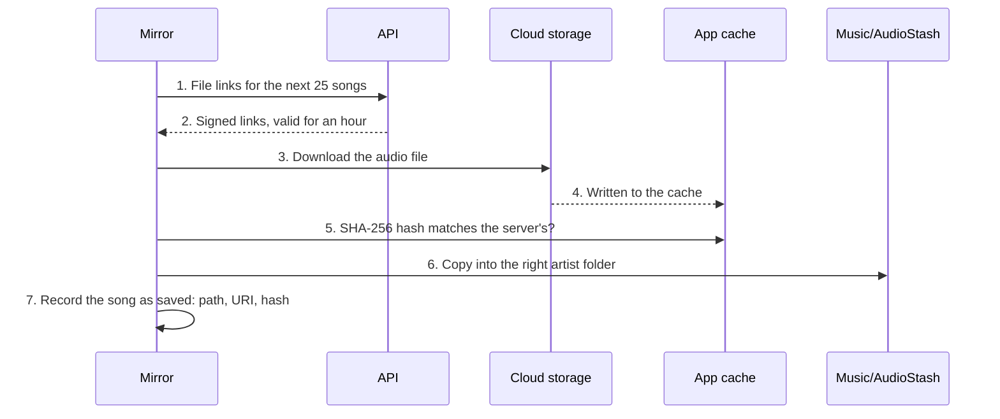

# Android storage and the music folder

AudioStash copies every song in the library to the phone, into `Music/AudioStash`, so other music players and a computer can see them. Android makes this harder than writing to a path. This note explains why, and how the app does it.

The decision itself is [ADR 0006](../adr/0006-music-folder.md).

## The parts

**App storage.** A private folder per app, at a path like `/data/user/0/dev.audiostash.app/files`. The app reads and writes it freely. No other app can see it, and Android deletes it when the app is uninstalled. AudioStash also uses its **cache**, a folder Android may empty when space runs low.

**Shared storage.** The part of the phone you see when you plug it into a computer: `Music`, `Download`, `Pictures` and so on. Many apps can see files here.

**Scoped storage.** The rules Android 10 and 11 introduced for shared storage. Before them, one permission let an app read and write anything in shared storage. Since then, an app sees only its own files plus whatever it is given in one of the ways below. The goal was to stop any app with storage permission from reading every photo and document on the phone.

**`content://` URI.** An address for a file handed out by another app or by Android, for example `content://com.android.externalstorage.documents/tree/primary%3AMusic%2FAudioStash`. It is not a path. The app passes it back to Android to read or write the file, and Android checks that the app is allowed.

**Storage Access Framework (SAF).** Android's system file picker plus the rules around it. When you pick a folder in it, the app gets permission to read and write everything inside that folder, and can keep the permission across restarts.

## Four ways to write music to shared storage

| Way              | What the owner sees                         | Files survive uninstall | Other players see them | Problem for AudioStash                                                             |
| ---------------- | ------------------------------------------- | ----------------------- | ---------------------- | ---------------------------------------------------------------------------------- |
| App storage      | Nothing                                     | No                      | No                     | Fails both of the owner's requirements                                             |
| MediaStore       | Nothing at first                            | Yes                     | Yes                    | After a reinstall, Android asks the owner to approve every change to the old files |
| SAF folder       | A folder picker, once                       | Yes                     | Yes                    | No paths, only URIs and folder listings                                            |
| All files access | A system settings page to switch on by hand | Yes                     | Yes                    | Gives access to every file on the phone; Google Play refuses most apps that ask    |

**MediaStore** is Android's index of media files. An app can add a song to `Music/` through it without any permission, and owns the files it adds. Ownership is tied to the installed app. Reinstall AudioStash, and the files belong to nobody it knows; renaming or deleting one shows a system prompt.

AudioStash uses a **SAF folder**, with app storage as the second choice for owners who want nothing outside the app.

## Choosing the folder

On first run the app shows "Where should songs go?" with two choices. "A folder in Music" opens the SAF picker already inside `Music`.

If you pick `Music` itself, or any folder not called `AudioStash`, the app creates `AudioStash` inside it. If you pick a folder called `AudioStash`, it uses that one. This way picking `Music` (the obvious tap) does not spread songs across your whole Music folder.

The app stores the folder's URI in its settings. If you later delete the folder, or remove AudioStash's access in Android settings, the URI stops working. The app notices before each run and asks you to choose again.

## Working without paths

With a path you can write `Music/AudioStash/Songs/Dua Lipa/Houdini.opus` in one call. With SAF you cannot. Each folder has its own URI, which you only learn by listing its parent. To reach `Houdini.opus` the app:

1. Lists `AudioStash` and finds `Songs`.
2. Lists `Songs` and finds `Dua Lipa`, or creates it.
3. Copies the file into `Dua Lipa`.

Listing is slow on some phones, so each run lists a folder at most once and remembers what it found. The lookup has no `await` in it, so two downloads finishing at once cannot both create `Dua Lipa`.

Shared storage ignores letter case: `dua lipa` and `Dua Lipa` are the same folder. The lookups ignore case too, or the app would try to create a folder that already exists.

## Saving one song

- **Step 1 asks for 25 at a time.** The links expire after an hour. Asking for all of them first would leave the last ones expired on a slow connection.
- **Step 4 writes to the cache, not the folder.** Downloads cannot write to a SAF URI directly, and a half-downloaded file in the music folder would show up in other players as a broken song.
- **Step 5 checks the hash.** A SHA-256 hash is a fingerprint of a file's bytes: any change gives a different hash. If it does not match the hash the server recorded, the file is not saved.
- **Step 6 copies into the folder.** Creating an empty file and writing into it would be simpler, but Android may add an extension of its own to a file created that way.
- **Three songs download at once.** One at a time leaves the connection idle while each file is copied.

## Keeping the folder in step

The mirror compares two lists:

- the songs the library has, each with its path and hash;
- the songs saved on the phone (the `saved_songs` table), each with its path and hash.

| Case                               | What happens                                                                 |
| ---------------------------------- | ---------------------------------------------------------------------------- |
| In the library, not saved          | Download it                                                                  |
| Saved, but the hash differs        | The audio changed: download it again, replace the file                       |
| Saved, but the path differs        | The title or artist was edited: save under the new name, delete the old file |
| Saved, not in the library any more | Delete the file                                                              |
| Same path and hash                 | Nothing                                                                      |

This comparison is a pure function in `plan.ts`: lists in, a plan out, no files touched. Unit tests check every case without a phone.

Each playlist becomes an `.m3u8` file: a text file listing song paths in order, which most music players read. It lists only songs already saved, so it never points at a missing file. A playlist file is rewritten only when its text would change.

## Mobile data

Songs are saved only on Wi-Fi unless you turn on "Save songs over mobile data" in settings. A library of a few hundred songs is several gigabytes. The app checks the connection before saving; on mobile data it shows how many songs are waiting. Moving to Wi-Fi starts a sync, and the mirror runs after it.

## Where the code is

| File                                                                                     | What it does                                      |
| ---------------------------------------------------------------------------------------- | ------------------------------------------------- |
| [apps/mobile/src/files/library-folder.ts](../../apps/mobile/src/files/library-folder.ts) | Choosing the folder, and finding it again         |
| [apps/mobile/src/files/plan.ts](../../apps/mobile/src/files/plan.ts)                     | What to save, replace and delete                  |
| [apps/mobile/src/files/mirror.ts](../../apps/mobile/src/files/mirror.ts)                 | Downloading, checking, copying, writing playlists |
| [apps/mobile/src/app/music-folder.tsx](../../apps/mobile/src/app/music-folder.tsx)       | The "Where should songs go?" screen               |

Check: you uninstall AudioStash, install it again and pick the same folder. What happens to the songs already there?

Uninstalling deleted the app's database, so `saved_songs` is empty and the plan says to save every song. Each one is downloaded again and copied over the file with the same name, so the folder ends with one copy of each. Signing out is different: it keeps `saved_songs`, so signing in again downloads nothing already saved. Skipping the downloads after a reinstall would need the app to read and hash the files already in the folder first.

Check: why is the mirror allowed to run only after a complete sync?

It deletes files whose songs are not in the local database. Partway through a sync, songs on later pages are not in the database yet, so their files would be deleted and downloaded again a moment later.

