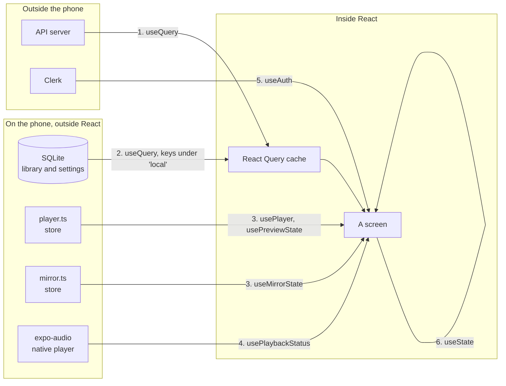
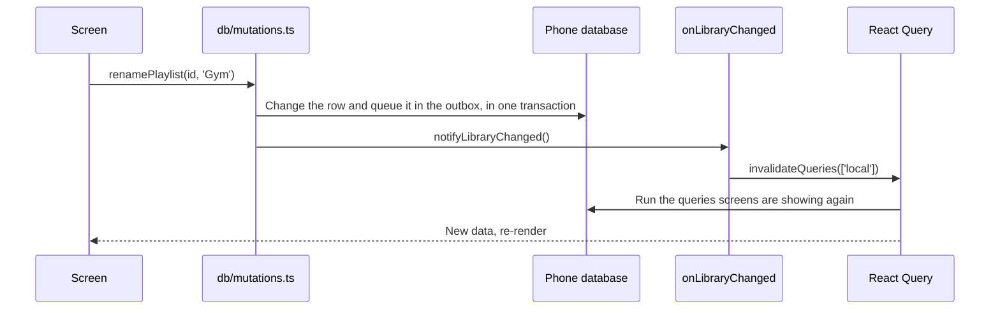

# State in the app: what each value is and where it comes from

A screen in AudioStash shows values from six different places: the server, the phone's database, the music player, the job that saves files, Clerk, and the screen itself. Each place has its own way to read a value and its own reason for the value to change. This note goes through them one at a time, so that for any variable in a screen you can say where it comes from and what changes it.

It builds on [The offline library and sync](offline-sync.md) and [Screens and navigation](navigation.md). [The tools note](tools.md) explains why React Query was chosen.

## The parts

**State.** A value that can change while the app runs and that the screen depends on, such as the song playing now or the text in the search box.

**Render.** React calls a component function to work out what it should show. A **re-render** is React calling it again because something it reads has changed. Re-rendering is cheap for one component, but a list of fifty rows re-rendering twice a second makes scrolling stutter. That is why several parts below go out of their way to re-render as little as possible.

**Hook.** A function whose name starts with `use` that a component calls to read state, such as `useState` or `useQuery`. Calling a hook also tells React to re-render the component when that state changes.

**Cache.** A kept copy of data that was slow to get, so the next reader gets it at once instead of fetching it again.

**Query key.** The name a React Query cache entry is stored under. It is an array, such as `['catalog', 'charts', 132]` for the chart of genre 132. Keys work like folders: `['catalog']` covers every key that starts with `'catalog'`.

**Stale.** React Query's word for "old enough to fetch again". `staleTime: 30 * MINUTE` means a cached chart is shown without asking the server for 30 minutes. After that it is still shown, but the next time a screen asks for it, React Query fetches it again in the background.

**Invalidate.** Marking cache entries stale on purpose, so any screen showing them fetches them again now. `invalidateQueries({ queryKey: ['local'] })` does this for every key that starts with `'local'`.

**Store.** A place outside any one component that holds a value, lets code read it, and tells whoever asked when it changes. In AudioStash a store is a plain TypeScript module with three things: a variable holding the value, a set of **listeners** (functions to call on a change), and a function that changes the value and then calls every listener. **Subscribing** means adding your listener to that set.

**Snapshot.** The value a store holds, as one object. It is never edited in place. A change builds a new object and replaces the old one. React tells "changed" from "unchanged" by comparing with `===`, which only sees a new object, not a changed field inside the same object.

**React Context.** React's built-in way to hand a value to every component below a point in the tree, without passing it down as a prop at each level. A **Provider** component near the top holds the value. Clerk and React Query each use one.

**Debounce.** Waiting until a value has stopped changing for a moment before acting on it. The search box waits 350 ms after the last key press before it searches.

## The six places

|     | Place                        | Read with                                        | Changed by                      | Lost when         |
| --- | ---------------------------- | ------------------------------------------------ | ------------------------------- | ----------------- |
| 1   | The server                   | `useCharts`, `useDownloads`, …                   | Refetching, live events         | The app closes    |
| 2   | The phone's database         | `useSongs`, `usePlaylists`, …                    | Your edits, sync                | Sign-out          |
| 3   | Module stores                | `usePlayer`, `usePreviewState`, `useMirrorState` | Functions in that module        | The app closes    |
| 4   | The native player's position | `usePlaybackStatus`                              | Playback itself, twice a second | The app closes    |
| 5   | Sign-in                      | `useAuth`                                        | Signing in and out              | Sign-out          |
| 6   | One screen                   | `useState`                                       | That screen                     | The screen closes |

## 1. Data from the server

**Where:** [api/queries.ts](../../apps/mobile/src/api/queries.ts). Each hook pairs a query key with a call from [api/endpoints.ts](../../apps/mobile/src/api/endpoints.ts), the file listing every API call the phone makes.

A hook such as `useCharts(genreId)` returns `{ data, isLoading, error }`. The first screen to ask for a chart fetches it. Every other screen that asks while it is cached gets the same copy at once.

| Hook                                                    | What it holds                                | Fresh for                     |
| ------------------------------------------------------- | -------------------------------------------- | ----------------------------- |
| `useGenres`                                             | Genre chips on Home                          | 24 hours                      |
| `useCharts`, `useTrending`, `useForYou`                 | Home's lists                                 | 30 minutes                    |
| `useSearchSongs`, `useSearchYoutube`                    | Search results                               | 10 minutes                    |
| `useDownloads('open' \| 'finished')`, `useDownload(id)` | The Downloads tab                            | 30 seconds, the app's default |
| `useStatus`                                             | Whether the API and the PC worker are online | Fetched every minute          |
| `useSessions`                                           | Devices signed in, in Settings               | 30 seconds                    |

The times differ because the data does. Charts change a few times a day, while a download's progress changes every second.

**What changes it**, apart from fetching again:

- **Live events.** While the app is on screen, the phone keeps one long request open to `GET /v1/events` ([api/events.ts](../../apps/mobile/src/api/events.ts)). The server writes an event into it whenever something happens, such as a download moving forward. `applyEvent` in queries.ts writes the news straight into the cache, so the Downloads tab moves with no new request.
- **Reconnecting.** Events sent while the stream was closed are lost. So each time it opens, [session.ts](../../apps/mobile/src/session.ts) invalidates the status and downloads keys, and those screens fetch fresh copies.

## 2. Data from the phone's database

**Where:** the same file, every key starting with `'local'`.

Your library lives in SQLite on the phone, so it works with no connection ([The offline library and sync](offline-sync.md) explains how). Screens still read it through React Query. The only difference is that the hook's function runs SQL instead of calling the API. Using the same tool means screens handle loading and errors the same way whatever the source.

| Hook                                                | What it holds                              |
| --------------------------------------------------- | ------------------------------------------ |
| `useSongs`                                          | Every song in the library                  |
| `usePlaylists`, `usePlaylist(id)`                   | Playlists, and one playlist with its songs |
| `useLibraryTotals`                                  | Counts and total size, for Settings        |
| `useLibraryFolder`                                  | The Android folder songs are saved to      |
| `useDefaultDownloadOptions`, `useMobileDataAllowed` | Settings                                   |

**What changes it:**

Sync takes the same path. When it pulls a change made on another device, it calls `notifyLibraryChanged()` too.

`onLibraryChanged` in [db/database.ts](../../apps/mobile/src/db/database.ts) is a small store of its own: a set of listeners and a function that calls them. It holds no value, only the news that something changed. The root layout listens and invalidates `['local']`. The player listens too, to drop deleted songs from the queue.

Screens never send a library edit to the API themselves. Otherwise an edit made with no connection would be lost, and even with one, the screen would not change until the server answered.

## 3. Module stores

Two modules keep state outside React and offer a hook to read it.

### The player

**Where:** [player/player.ts](../../apps/mobile/src/player/player.ts), read through [player/hooks.ts](../../apps/mobile/src/player/hooks.ts).

The player lives outside React for three reasons:

- **Music outlives screens.** Screens are created and destroyed as you move around. A module stays loaded for as long as the app runs.
- **Code with no React in it changes it.** The lock screen buttons, the native player's "next song started" events and sign-out all change the player. None of them can call a hook.
- **One player.** Two copies would play two songs at once.

Its snapshot:

| Field            | Meaning                                                                                                                     |
| ---------------- | --------------------------------------------------------------------------------------------------------------------------- |
| `source`         | Where the queue came from: a playlist's id and name, or `'all'` for All songs. Now Playing uses it for "Open the playlist". |
| `queue`          | The songs in the order they will play, shuffled or not                                                                      |
| `position`       | Which entry in `queue` is playing                                                                                           |
| `current`        | The song playing: `queue[position]`, or `null` when nothing is loaded                                                       |
| `shuffle`        | `true` or `false`                                                                                                           |
| `repeat`         | `'none'`, `'all'` or `'single'`                                                                                             |
| `previewId`      | The catalog song whose 30-second preview is playing, or `null`                                                              |
| `previewLoading` | `true` from the tap until the preview's link has loaded and playback has begun                                              |

The module also keeps values the snapshot does not show: the native players, the list as chosen (`songs`), the play order (`order`), and whether this play has been counted yet (`playCounted`). Screens never read them. They only call the module's functions, such as `playSongs`, `next` and `togglePreview`.

Two hooks read the snapshot:

- `usePlayer()` returns all of it. The mini player, Now Playing and the playlist screen use it.
- `usePreviewState(trackId)` returns only `null`, `'loading'` or `'playing'`: "what is my song's preview doing?" The song rows and cards on Home and Search use it to draw a spinner or a pause icon on the cover.

Both are built on React's `useSyncExternalStore(subscribe, read)`. React calls `subscribe` once, to add a listener. On every change it calls `read` again and compares the result with the last one using `===`. It re-renders only if they differ. So when you tap song B while song A's preview plays, only rows A and B re-render. A's answer went from `'playing'` to `null` and B's from `null` to `'loading'`. Every other row still answers `null`.

### The mirror

**Where:** [files/mirror.ts](../../apps/mobile/src/files/mirror.ts), read with `useMirrorState()` from [files/hooks.ts](../../apps/mobile/src/files/hooks.ts).

The mirror copies song files onto the phone and deletes files of songs you removed ([Android storage](android-storage.md) explains how). Its state feeds the progress line on the Downloads tab:

| Field           | Meaning                                                                                                                     |
| --------------- | --------------------------------------------------------------------------------------------------------------------------- |
| `status`        | `'idle'`, `'saving'`, `'waitingForWifi'`, `'noFolder'` (no folder chosen yet) or `'folderMissing'` (the folder was deleted) |
| `done`, `total` | Songs saved so far in this run, out of how many it set out to save                                                          |
| `bytesLeft`     | Size of the songs still to save                                                                                             |
| `failed`        | Songs that could not be saved. The next run tries them again.                                                               |

### Two smaller modules with no hook

- **[sync/engine.ts](../../apps/mobile/src/sync/engine.ts)** keeps `running` (the sync in progress, if any) and `runAgain` (another request arrived meanwhile). Other code calls `onSynced(listener)` to hear when a full sync finishes. Session uses it to start the mirror, which deletes the files of songs missing from the phone's database. Otherwise, while the library is still being pulled after you sign in, the mirror would see songs not pulled yet as deleted, and delete their files.
- **[downloads/add-request.ts](../../apps/mobile/src/downloads/add-request.ts)** keeps `pending`: what you tapped Download on, from the moment you tap until the download sheet opens and reads it. A screen's URL can carry short text only, not a whole song object, so the song waits here.

## 4. The playback position

**Where:** `usePlaybackStatus()` in [player/hooks.ts](../../apps/mobile/src/player/hooks.ts), which comes from expo-audio.

It holds `currentTime`, `duration` and `playing`, straight from the native player. It is kept apart from the player snapshot because it changes twice a second while music plays. If it were in the snapshot, every component reading the snapshot would re-render twice a second, including every song row on Home.

So only three places use it, all of which draw a moving progress bar or a play/pause button: the mini player, Now Playing and the playlist screen.

## 5. Sign-in

**Where:** Clerk's `useAuth()`, used in [app/_layout.tsx](../../apps/mobile/src/app/_layout.tsx).

`isLoaded` is `true` once Clerk has checked for a saved login. `isSignedIn` is `true` while you are logged in. The root layout shows nothing until `isLoaded`, then shows either the sign-in screen or the app. [Authentication with Clerk](auth.md) explains the rest.

This one is React Context: `<ClerkProvider>` wraps the whole app. `<QueryClientProvider>`, which every `useQuery` above needs, is Context too.

## 6. One screen's own state

**Where:** `useState` in the screen. It belongs to that screen and is gone when the screen closes. This is ordinary React, the same as on the web.

| Screen                     | Values                                                                                                  | Meaning                                                                                                                                                                                                   |
| -------------------------- | ------------------------------------------------------------------------------------------------------- | --------------------------------------------------------------------------------------------------------------------------------------------------------------------------------------------------------- |
| Root layout                | `databaseOpen`                                                                                          | Show nothing until SQLite is open                                                                                                                                                                         |
| Home                       | `genre`, `showAll`, `refreshing`                                                                        | The genre chip picked; Top 50 shows a few rows or all 50; pull-to-refresh spinner                                                                                                                         |
| Search                     | `input`, `tab`, `notice`                                                                                | What you typed; Songs or YouTube; a message such as "no link on the clipboard". `useDebounced` turns `input` into the search text 350 ms after you stop typing, so the API is not called on every letter. |
| Playlists                  | `filter`, `naming`                                                                                      | All, yours or imported playlists; the playlist being named, when the name box is open                                                                                                                     |
| Playlist                   | `reordering`, `renaming`                                                                                | Drag-to-reorder mode; the rename box is open                                                                                                                                                              |
| Add songs                  | `filter`, `selected`                                                                                    | Text in the filter box; songs ticked so far                                                                                                                                                               |
| Download sheet (`add.tsx`) | `downloadId`, `newPlaylistId`, `options`, `target`, `choosingTarget`, `busy`, `uploadProgress`, `error` | Ids made once when the sheet opens; quality and format; which playlist to add to; whether the playlist picker shows; what is in progress; upload progress; the last error                                 |
| Choose playlist            | `naming`, `name`                                                                                        | The new playlist box is open; its text                                                                                                                                                                    |
| Now Playing                | `width`, `dragging`                                                                                     | The progress bar's measured width; where your finger is while dragging it                                                                                                                                 |
| Sign-in                    | `step`, `email`, `password`, `code`, `newPassword`, `error`, `ssoStrategy`                              | Which step of sign-in; the form fields; the last error; which sign-in with another account (Google, Apple, GitHub, …) is running                                                                          |
| Music folder               | `busy`                                                                                                  | A folder is being chosen and checked                                                                                                                                                                      |

`downloadId` is made once, when the sheet opens, and kept. The server treats two requests with the same id as one. So a double tap on Download, or a retry after a dropped connection, cannot start two downloads.

## One tap, end to end

Tapping a song on Home to hear its preview touches four of the six places.

1. `TrackRow` was drawn from **the server's data** (place 1): `useCharts` gave it the song, including `previewDeezerId`.
2. The tap calls `togglePreview` in **the player store** (place 3). It pauses the queue and sets `previewId` to this song with `previewLoading` on, which redraws only this row, with a spinner.
3. The player asks the API for a fresh preview link, then plays it on its second, preview-only player, and turns `previewLoading` off. The row swaps the spinner for a pause icon. The spinner covers only the wait for the link, the slow part: on a slow connection the icon can appear a moment before the sound.
4. If the API cannot give a link, `togglePreview` throws, the row shows the error as a toast, and `previewId` goes back to `null`. If the clip plays to the end, the player sets `previewId` back to `null` too, and the overlay goes.
5. If you then play a song from a playlist, the mini player appears. It reads `current` from the player store and the moving position from **the native player** (place 4).

## Choosing a place for new state

Ask in this order:

1. **Does it come from the server?** Add a hook to queries.ts. React Query then handles loading, errors, caching and refetching, which you would otherwise write yourself.
2. **Is it part of the library or a setting?** Store it in SQLite, read it under a `'local'` key, and change it through db/mutations.ts. It then survives restarts and works offline.
3. **Must it outlive screens, or be changed by code that is not a component?** Make it a module store, like player.ts. Give it a hook built on `useSyncExternalStore`, and have the hook return the smallest value a component needs, so that fewer components re-render.
4. **Otherwise**, use `useState` in the screen. Most state is this kind, and it is the easiest to follow, because everything that changes it is in one file.

Context is the right tool for a value many components need that changes rarely, which is why Clerk and React Query use it. Every component using a Context re-renders when its value changes, so it is the wrong tool for anything that changes often, such as the player.

## Check yourself

The Downloads tab shows a download at 40%, then 41%, with no pull-to-refresh. Which place is that, and what changed it?

Place 1, the server's data in React Query, under the key `['download', id]`. A live event arrived on the event stream and `applyEvent` wrote the new progress into the cache.

You rename a playlist in airplane mode. Why does the new name appear at once?

The rename goes through db/mutations.ts, which writes it to the phone's database and queues it in the outbox in one transaction. Then `notifyLibraryChanged()` invalidates the `['local']` queries, and the playlist screen reads the new name from SQLite. The server is not needed until the outbox is sent later.

Why does the song row use <code>usePreviewState(track.id)</code> instead of reading <code>usePlayer().previewId</code>?

`usePlayer()` returns the whole snapshot, a new object on every player change. Every row would re-render on every change: each new song, shuffle, repeat. `usePreviewState` returns `null` for every row but the one previewing, so only the rows whose preview starts, loads or stops re-render.

Why is the search box's text in <code>useState</code> and not in a store?

Only the Search screen needs it, and nothing outside React changes it. Losing it when the screen closes is fine.

