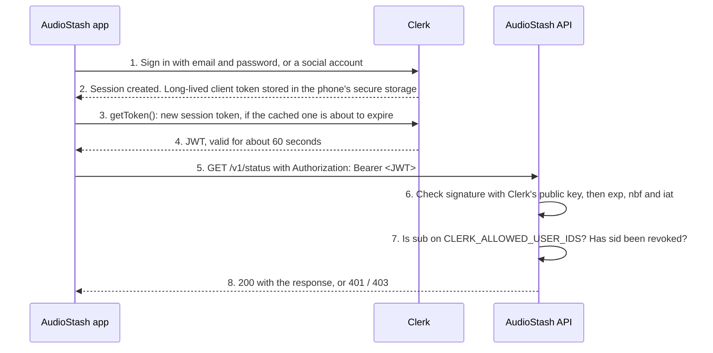

# Authentication with Clerk

The API must know that a request comes from you and not from someone who found its address. This note explains how AudioStash checks that, and why each part is built the way it is.

Two words first:

- **Authentication** answers "who is this?". A bad or missing token gets **401 Unauthorized**.
- **Authorization** answers "is this person allowed?". A valid token for someone who is not allowed gets **403 Forbidden**.

## The parts

**Clerk** is a hosted sign-in service. It stores accounts, passwords and sessions, and signs you in with Google, Apple, GitHub or Facebook. It also emails one-time codes, to reset a password or to confirm a sign-in from a new device. The free plan covers far more users than AudioStash needs. AudioStash itself stores no passwords: the phone sends the password to Clerk, never to the AudioStash API.

**Session.** Each time you sign in on a device, Clerk creates a session for it. A session lasts days or weeks (set in the Clerk dashboard) and ends when you sign out or it is revoked. Clerk stores it, and gives it an id like `sess_2Ro7e2…`.

**Session token.** A short proof that a session is active, sent with each API request. Clerk issues a new one roughly every minute. It is a JWT.

**JWT (JSON Web Token).** Three base64url-encoded parts joined by dots: `header.payload.signature`.

- The header says how it was signed: `{"alg": "RS256", "kid": "ins_2Ab…"}`.
- The payload holds **claims**, which are facts about the token:

  | Claim | Meaning                                            |
  | ----- | -------------------------------------------------- |
  | `sub` | Subject: the Clerk user id, `user_…`               |
  | `sid` | The session id, `sess_…`                           |
  | `iat` | Issued at, in seconds since 1970                   |
  | `nbf` | Not valid before this time                         |
  | `exp` | Expires at this time, about 60 seconds after `iat` |

- The signature is made from the header and payload with Clerk's **private key**.

Base64url is an encoding, not encryption. Anyone holding a token can read its claims. What they cannot do is change a claim, because the signature would no longer match.

**RS256** is the signing method. It uses a key pair. Clerk keeps the private key and signs with it. Anyone can have the public key and use it to check a signature, but cannot sign with it. So the API can check tokens without holding any secret that could forge them.

**JWKS (JSON Web Key Set).** The list of public keys Clerk publishes for your app. Each key has an id; the token's `kid` header says which key signed it. The API downloads the list once and caches it. Setting `CLERK_JWT_KEY` gives the API the public key directly, so it never needs to download it.

## One request, in order

Steps 6 and 7 run in the `requireUser` middleware on every app route. Step 6 makes no network call once the public key is known. The handler then reads `c.get('user')`, which holds `{ userId, sessionId }`.

## Why tokens last only a minute

The API checks a token using only the token and a public key. It does not ask Clerk whether the session is still active. That keeps each request fast and lets the API work while Clerk is slow.

The cost: the API cannot tell when a session has been revoked. A token signed a few seconds before you revoked its session still has a valid signature. Clerk limits the damage by making tokens expire after about 60 seconds. The phone's Clerk SDK fetches a new token before the old one expires, and Clerk refuses to issue one for a revoked session. So a revoked device is locked out within a minute.

AudioStash closes that last minute too. When you sign a device out through the API, the API remembers the session id for 5 minutes and refuses its tokens. Five minutes is longer than any token for that session can live. This memory is per API process, which is fine because AudioStash runs one.

## Why there is an allow-list

Clerk's sign-up mode is set to **Restricted**, so nobody can create an account. You add yourself in the dashboard. The API still checks `sub` against `CLERK_ALLOWED_USER_IDS`. If the dashboard setting were changed by mistake, a stranger could create an account and get a valid token; the allow-list still refuses them with 403. Two independent checks mean one mistake is not enough.

## Signed-in devices

A device in AudioStash's settings screen is a Clerk session. There is no devices table in AudioStash's database; Clerk already stores sessions with the time and place they were last used.

| Request                   | What happens                                                                             |
| ------------------------- | ---------------------------------------------------------------------------------------- |
| `GET /v1/sessions`        | Lists your active sessions from Clerk, marking the one making the request as `current`   |
| `DELETE /v1/sessions/:id` | Revokes the session at Clerk, remembers it as revoked, and closes its live event streams |

The live event stream (`GET /v1/events`, Server-Sent Events) is one HTTP response that stays open for hours. Its token is checked once, when it opens, so a token expiring later does not end it. That is why revoking a session also closes its streams.

## Mobile and web differ here

A website using Clerk usually keeps the session token in a **cookie**. The browser attaches cookies to every request to that site on its own. Because of that, websites must also defend against cross-site request forgery: another site tricking the browser into sending a request with your cookie attached.

A native app has no browser doing this. The app adds the `Authorization: Bearer` header itself, on each request. Nothing is sent automatically, so cross-site request forgery does not apply. The long-lived client token is kept in the phone's secure storage (the Android Keystore, through `expo-secure-store`), not in a cookie jar.

## The worker uses a shared secret, not Clerk

The worker is a program on your PC, not a person. It has no sign-in screen, and nobody is there to sign it in again when a session ends. It sends `WORKER_TOKEN`, one long random string the API and worker both have in their environment.

|                       | Session token (phone)                         | `WORKER_TOKEN` (worker)                              |
| --------------------- | --------------------------------------------- | ---------------------------------------------------- |
| Kind                  | JWT: carries its own claims and signature     | Opaque: a random string that means nothing by itself |
| How the API checks it | Signature and expiry, with Clerk's public key | Compares it with its own copy                        |
| Lifetime              | About a minute                                | Until you change it                                  |
| If it leaks           | Useless after a minute                        | Works until you change it on both sides              |

The comparison uses `timingSafeEqual`. An ordinary `===` stops at the first character that differs, so it returns slightly faster the earlier the mismatch is. An attacker sending many guesses and timing the answers could learn the token one character at a time. `timingSafeEqual` takes the same time whatever the inputs. It needs both inputs to be the same length, so both strings are hashed with SHA-256 first.

Worker routes refuse session tokens, and app routes refuse `WORKER_TOKEN`. A leaked phone token cannot claim jobs, and a leaked worker token cannot read your library through the app routes.

## Where the code is

| File                                                                             | What it does                                                                                   |
| -------------------------------------------------------------------------------- | ---------------------------------------------------------------------------------------------- |
| [apps/api/src/services/clerk.ts](../../apps/api/src/services/clerk.ts)           | The only file that talks to Clerk: checks tokens, lists and revokes sessions                   |
| [apps/api/src/services/auth.ts](../../apps/api/src/services/auth.ts)             | The rules: allow-list, revoked sessions, worker token                                          |
| [apps/api/src/middleware/auth.ts](../../apps/api/src/middleware/auth.ts)         | `requireUser` and `requireWorker`, used by the routers                                         |
| [apps/api/src/services/clerk.test.ts](../../apps/api/src/services/clerk.test.ts) | Makes its own RSA key pair and signs real tokens, so token checks are tested without a network |
| [apps/api/scripts/token.ts](../../apps/api/scripts/token.ts)                     | `pnpm token` prints a token for trying the API with curl                                       |

## Things people get wrong

| Belief                                           | What is true                                                                                                                   |
| ------------------------------------------------ | ------------------------------------------------------------------------------------------------------------------------------ |
| A JWT is encrypted                               | It is only encoded. Anyone can read it. The signature stops changes, not reading.                                              |
| Signing out on the phone stops its token at once | The token works until `exp`. AudioStash's API refuses it sooner only when the sign-out went through `DELETE /v1/sessions/:id`. |
| 401 and 403 are interchangeable                  | 401: we do not know who you are. 403: we know, and the answer is no.                                                           |
| The public key must be kept secret               | It can only check signatures, not make them. The secret key (`CLERK_SECRET_KEY`) is the one to protect.                        |

## Adding more users later

AudioStash is built for one owner. To let others have their own libraries:

1. Store users. Clerk calls a webhook on your API when a user signs up (`user.created`), and the API inserts a row into a `users` table. Spritegen does this.
2. Add a `user_id` column to songs, playlists and downloads, and filter every query by it.
3. Store each user's files under their own prefix in the bucket.
4. Allow sign-ups in Clerk and remove the allow-list.

Step 2 is the large one: every query in the API changes.
