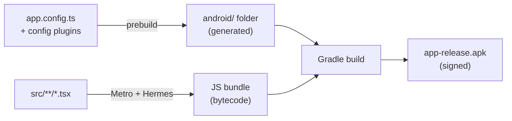

# Expo, and how the app becomes an APK

The app in `apps/mobile` is written in TypeScript and React. This note explains how that code becomes an Android app on your phone, what Expo adds on the way, and why some settings are the way they are.

## The parts

**React Native.** A framework that runs React code on a phone. Components such as `<View>` and `<Text>` become real Android views, not a web page. Your code runs on a JavaScript engine inside the app and asks the Android side to draw and update views.

**Hermes.** The JavaScript engine React Native uses. At build time the code is compiled to Hermes bytecode, a compact form that starts faster than plain JavaScript. The `.hbc` file in a bundle is that bytecode.

**Native module.** Code written for Android (Kotlin or Java) that JavaScript can call, for things JavaScript cannot do alone: play audio, open a SQLite database, show the folder picker.

**Expo.** A set of native modules (`expo-audio`, `expo-sqlite`, `expo-file-system` and others) plus the tools that build the app. Each Expo SDK version is tested with one React Native version and one version of each module, so upgrading means moving everything together. Pluck uses SDK 58 with React Native 0.88.

**Metro.** The bundler. It follows the imports from the entry file and writes one JavaScript bundle holding the whole app.

## From source to APK

1. **Prebuild** writes the `android/` folder from `app.config.ts`. **Config plugins** are functions that edit the generated native files. For example, the `expo-audio` plugin adds the media playback service and its permissions to `AndroidManifest.xml`, and the splash screen plugin writes the splash images and colours.
2. **Metro** bundles `src/` and Hermes compiles it to bytecode.
3. **Gradle**, Android's build tool, compiles the native code, adds the bundle, and signs the result.

`android/` is in `.gitignore`. It is generated, so it is never edited by hand. Expo calls this Continuous Native Generation. The reason: when Expo releases a new SDK, the native project is regenerated from the config instead of merging changes into hand-edited native files.

## Settings baked into the app

`apps/mobile/.env` holds three values:

| Name                                | What it is                           |
| ----------------------------------- | ------------------------------------ |
| `EXPO_PUBLIC_API_URL`               | The API's address                    |
| `EXPO_PUBLIC_CLERK_PUBLISHABLE_KEY` | Clerk's public key for the app       |
| `EXPO_PUBLIC_CHART_COUNTRY`         | The country for Home's trending list |

Metro replaces `process.env.EXPO_PUBLIC_…` with the value itself while bundling. The phone has no environment variables to read at run time; the value is part of the bundle. Two consequences:

- **Nothing secret goes here.** Anyone with the APK can read the bundle. The Clerk publishable key is designed to be public; the Clerk secret key lives only on the API.
- **Each one is written out in full.** Metro finds them by looking for the exact text `process.env.EXPO_PUBLIC_API_URL`. Code such as `process.env[name]` is not replaced and reads `undefined`. That is why [config.ts](../../apps/mobile/src/config.ts) names each one.

For builds on EAS (below), the same names are set with `eas env:create`, because `.env` is not committed and so never reaches the build server.

## Debug and release builds

|                           | Debug build                              | Release build (the APK)   |
| ------------------------- | ---------------------------------------- | ------------------------- |
| Where the code comes from | Metro on your computer, over the network | The bundle inside the APK |
| Plain `http://`           | Allowed                                  | Refused                   |
| Needs your computer       | Yes, running Metro                       | No                        |

Since Android 9, apps refuse plain `http://` connections unless they opt in. Debug builds opt in so they can load code from Metro. Release builds do not. This is why the APK needs the API on `https://`, which the cloud deploy provides. The same applies to the file links from storage.

## APK and AAB

An **APK** (Android package) installs directly on a phone. An **AAB** (Android App Bundle) is what Google Play takes; Play turns it into APKs for each phone. Pluck is never published to a store, so it builds an APK. To install one you allow your browser or file manager to "install unknown apps" when Android asks.

## Signing

Android refuses to install an update unless it is signed with the same key as the version already installed. The **keystore** is the file holding that key.

- EAS makes a keystore on the first build and keeps it, so every EAS build updates the last one.
- A local build signs with a different key.

Switching between the two means uninstalling first. Uninstalling deletes the app's database, so the library is pulled again and every song is downloaded again into the music folder (see [Android storage](android-storage.md)). Pick one way to build and stay with it.

## EAS Build

EAS (Expo Application Services) Build runs the steps above on Expo's servers. The free plan includes a monthly allowance of builds; free builds wait in a shared queue, often for some minutes. No Java or Android SDK is needed on your computer.

`eas.json` has one profile, `preview`, which makes an APK (`buildType: "apk"`) instead of an AAB. The README has the commands.

## Checking the app without a phone

These checks need no Android tools, so they run on any computer:

| Check                                | What it proves                                                             | What it cannot prove                   |
| ------------------------------------ | -------------------------------------------------------------------------- | -------------------------------------- |
| `pnpm typecheck`                     | Types line up across the app and the shared packages                       | Behaviour                              |
| `pnpm test`                          | Logic with no React Native imports: sync planning, queue order, formatting | Anything that needs a phone            |
| `pnpm --filter @pluck/mobile bundle` | Metro finds every import and Hermes compiles the whole app                 | That native modules behave as expected |
| `npx expo-doctor` (in `apps/mobile`) | Package versions match the Expo SDK                                        |                                        |

Native behaviour (audio, the folder picker, background playback) is checked only by running the app: a debug build on an emulator or a USB phone (see the README), or the APK.

## Where the code is

| File                                                                           | What it does                                      |
| ------------------------------------------------------------------------------ | ------------------------------------------------- |
| [apps/mobile/app.config.ts](../../apps/mobile/app.config.ts)                   | Name, icons, package id, config plugins           |
| [apps/mobile/eas.json](../../apps/mobile/eas.json)                             | EAS build profiles                                |
| [apps/mobile/.env.example](../../apps/mobile/.env.example)                     | The settings baked into the app                   |
| [apps/mobile/src/app](../../apps/mobile/src/app)                               | Screens. Expo Router turns each file into a route |
| [apps/mobile/scripts/make-icons.mts](../../apps/mobile/scripts/make-icons.mts) | Draws the app icons from the logo                 |

Check: you change <code>EXPO_PUBLIC_API_URL</code> in <code>.env</code> and reopen the installed APK. Does it use the new address?

No. The old address was written into the bundle when the APK was built. The app has to be built again.

Check: why is it fine for the Clerk publishable key to be inside the APK, but not the worker token?

The publishable key only identifies which Clerk application to sign in to; signing in still needs your email and a code. The worker token lets whoever holds it claim jobs and write songs, with no sign-in at all.

