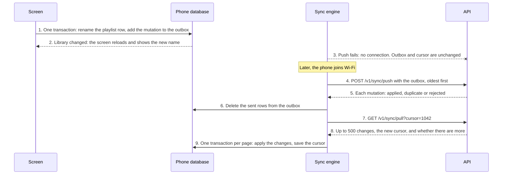

# The offline library and sync

AudioStash's app works with no connection: you can browse the library, play songs, and edit playlists. This note explains how the phone keeps its own copy of the library, how edits made offline reach the server, and how the phone hears about changes made elsewhere.

The decisions behind it are in [ADR 0004](../adr/0004-sync-through-a-change-log.md) and [ADR 0005](../adr/0005-local-database-on-the-phone.md). This note explains how it works.

## The parts

**Source of truth.** The copy that wins when two copies disagree. For AudioStash that is the server's Postgres database. The phone's copy is always rebuilt from it.

**SQLite.** A database stored in one file, with no server process. Android ships it, and `expo-sqlite` lets the app use it. The phone's file is `audiostash.db`.

**Transaction.** A group of writes that all happen or none do. If the app is closed halfway through, the database is left as it was before the transaction started.

**Change log.** A table on the server, `library_changes`, with one row per change to a song, playlist or playlist entry. Each row has a number, and numbers only go up. A row says what changed, for example `song.upserted` with the song's new data, or `entry.deleted` with an id. "Upserted" means inserted or updated.

**Cursor.** The number of the last change the phone has applied. The phone stores it in its `settings` table. To catch up it asks for "changes after cursor 1042".

**Outbox.** A table on the phone holding edits not yet sent to the server, in the order they were made. Each row is one **mutation**: an edit with its own id, such as "rename playlist X to Y".

**Idempotent.** Safe to repeat. Sending the same mutation twice has the same effect as sending it once, because the server records each mutation id it has applied and skips one it has seen.

## An edit, in order

You rename a playlist on the train with no signal, then reach Wi-Fi.



Step 1 is why the app feels instant offline: the screen reads the local database, and the local database already has the edit. Steps 1 to 3 never wait for the network.

Step 4 sends mutations in the order they were made. Order matters: "create playlist" must arrive before "add songs to it".

Step 7 runs after the push, so the pull returns the phone's own edits as the server stored them. If the server changed something (for example, it picks a file name for a renamed song), the phone gets the server's version.

Step 9 saves the cursor in the same transaction as the changes. If the app is closed between pages, the next sync starts from the last page fully applied, never from halfway through one.

## When sync runs

`requestSync()` is cheap to call often. If a sync is already running, the call marks that one more run is needed and returns the running one. Ten calls in a row produce at most two runs.

It is called:

- after every local edit;
- when the live event stream connects or reconnects;
- when the server says the library changed (a `library.changed` event);
- when the phone comes back online.

A failed sync logs a warning and stops. The outbox and the cursor are unchanged, so the next run carries on where this one stopped.

## When the server says no

A mutation can be rejected. For example, phone A adds a song to a playlist that phone B deleted a minute ago. Phone A has already shown the song in the playlist (step 1).

The server answers `rejected` for that mutation. The phone sets a `resync` flag. The next pull starts from cursor 0, and its first page deletes the local songs, playlists and entries before applying the changes. The whole library is replaced with the server's copy, which undoes the rejected edit.

This is simpler than undoing one edit: the phone would need to know what each edit changed and what the row looked like before. With one owner, rejections are rare, so a full reload costs little.

## The live event stream

The Downloads tab shows progress as the worker downloads, and a new song appears in the library within a second of finishing. The server pushes these updates to the phone over **Server-Sent Events (SSE)**: an HTTP response that never ends, where the server writes one short text message at a time.

```
event: download.item.progress
data: {"type":"download.item.progress","downloadId":"…","itemId":"…","stage":"downloading","progress":0.62}

```

A blank line ends each message.

Why SSE and not a WebSocket: the server only talks and the phone only listens. SSE is an ordinary HTTP request, so the API's normal sign-in check runs on it unchanged. A WebSocket is two-way, which AudioStash does not need, and starts as HTTP before switching to its own protocol, so the sign-in check and the server code need separate handling for it.

The app handles three problems with the stream:

| Problem                                                                               | What the app does                                                                                                                                    |
| ------------------------------------------------------------------------------------- | ---------------------------------------------------------------------------------------------------------------------------------------------------- |
| Mobile networks drop connections without closing them, so the app would wait forever. | The server sends a `ping` every 25 seconds. 60 seconds with nothing received means the connection is dead, and the app reconnects.                   |
| Events sent while disconnected are lost; the server does not replay them.             | Every (re)connect runs a sync and reloads the downloads list. The stream says "something changed"; the change log and the API hold the actual state. |
| A server restart would make every phone reconnect at the same moment.                 | Retries wait 1, 2, 4 … up to 30 seconds, times a random factor between 0.5 and 1, so phones spread out.                                              |

The stream is open only while the app is on screen. In the background it would keep the radio awake and drain the battery. Opening it again syncs, which picks up whatever happened meanwhile.

React Native's built-in `fetch` cannot read a response body as it arrives; it waits for the whole body, which for SSE never comes. The app uses `fetch` from `expo/fetch`, which can.

## After sync: saving the songs

The music folder on the phone is made to match the library by the mirror (see [ADR 0006](../adr/0006-music-folder.md) and [Android storage](android-storage.md)). It runs only after a sync that pulled everything, never after a partial one.

The reason: the mirror deletes files of songs that are not in the local database. After a partial pull, songs on later pages are missing from the database for a moment. The mirror would delete their files, and download them again once the pull finished.

## Signing out

Sign-out runs these steps in order. Each one depends on the one before.

1. Stop the mirror, and wait for songs being saved to finish. Otherwise a run could see the empty library in step 5 and delete every file.
2. Stop playback, so the player does not hold files of a library that is about to go.
3. Sign out of Clerk. From now on, any request to the API fails.
4. Wait for a sync that was already running to end. A new one fails at once.
5. Delete the songs, playlists, entries, outbox and cursor.

The record of saved files stays, with each file's path and hash. Signing in again pulls the library and compares it with that record, so only songs not already saved are downloaded. Edits still in the outbox at step 5 are lost.

## Where the code is

| File                                                                     | What it does                                                      |
| ------------------------------------------------------------------------ | ----------------------------------------------------------------- |
| [apps/mobile/src/db/database.ts](../../apps/mobile/src/db/database.ts)   | Tables, migrations, and the "library changed" signal              |
| [apps/mobile/src/db/mutations.ts](../../apps/mobile/src/db/mutations.ts) | Every edit: applied locally and queued in one transaction         |
| [apps/mobile/src/sync/engine.ts](../../apps/mobile/src/sync/engine.ts)   | Push, pull, resync                                                |
| [apps/mobile/src/api/events.ts](../../apps/mobile/src/api/events.ts)     | The event stream: connect, silence timer, retries                 |
| [apps/mobile/src/api/sse.ts](../../apps/mobile/src/api/sse.ts)           | Turns arriving text into messages; tested on awkward chunk splits |
| [apps/mobile/src/session.ts](../../apps/mobile/src/session.ts)           | What starts at sign-in and the sign-out order                     |
| [apps/api/src/services/sync.ts](../../apps/api/src/services/sync.ts)     | The server side of push and pull                                  |

<details>
<summary>Check: the app saves the cursor in the same transaction as the changes. What could go wrong if it saved the cursor afterwards, in a separate write?</summary>

If the app closed between the two writes, the changes would be applied but the cursor would still point before them. The next pull would apply the same page again. For upserts and deletes that happens to be harmless, but the phone would download the page twice and the code would rely on every change type being safe to repeat. One transaction removes the question.
</details>

<details>
<summary>Check: why does the app sync when the event stream reconnects, rather than asking the server to resend the events it missed?</summary>

Resending would need the server to keep every event per phone until that phone confirms it, which is a second change log. The real change log already exists and the phone already has a cursor into it. The stream only needs to say "look now".
</details>
